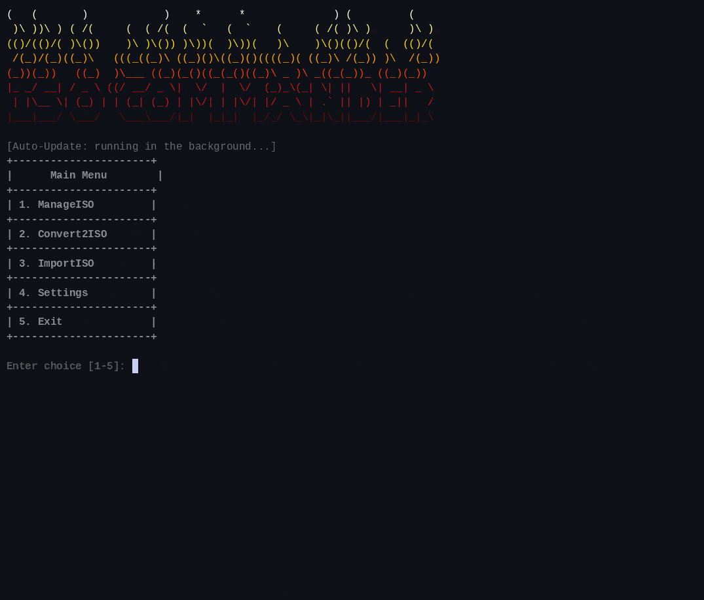

# iso-commander
Mount ISOs, convert images, write bootable USB drives — done right



## Getting Started

### Installation

1. **Arch Linux (AUR)** — `yay -S iso-commander` or `yay -S iso-commander-bin`
2. **Static Binary** — Download from the [latest release](https://github.com/siyia2/iso-commander/releases)
3. **Source** — `make` (GCC 15+ with the C++23 standard library module; GCC 16+ recommended)

### Dependencies

| Platform | Packages |
|--------|----------|
| Arch | `readline` `util-linux` |
| Debian | `libreadline-dev` `libmount-dev` `libblkid-dev` |
| Agnostic | `libchdr` (statically built and linked) |
| Optional (Windows writer) |`dosfstools` `ntfsprogs`/`ntfs-3g` `parted` |

<br>

**Supported Operations**
> Mount · Unmount · Copy · Move · Delete · Write to USB · Convert to ISO

**Convert to ISO — Supported Formats (archival only — breaks emulator compatibility)**
> `.bin` · `.img` · `.chd` · `.daa` · `.gbi` · `.mdf` · `.nrg`

### Notes
- Root access is required for `mount`, `umount`, and `write` operations. Run with `sudo isocmd`
- ISO files are mounted under `/mnt/ISOs/`
- Converted files are saved to the source ISO's directory
- Config: `/root/.config/isocmd/config` — Database: `/root/.local/share/isocmd/database/`

> Non-root equivalents use `~/.config/isocmd/` and `~/.local/share/isocmd/` respectively

## Features

⚡ **High-Performance Architecture**
- Single self-contained executable binary
- Native C++ — no Python runtime, no shell wrappers
- Multithreaded, lock-free processing — scales from 1 to 10,000 ISO files

💾 **Smart ISO Management**
- Persistent database with atomic writes
- Minimized disk thrashing and optimized file access
- Optional automatic imports to database

🖥️ **Terminal Interface**
- Tab completion, pagination, and command history
- Real-time progress tracking and non-interactive mode
- Built-in theme engine with full RGB color support

🖊️ **Best-in-Class USB Write Engine**
- Automatic ISO detection — custom write method for Windows vs. others
- No wimlib, no file splitting — `install.wim` routed to NTFS natively
- Dynamic NTFS driver selection — `NTFSPLUS` is preferred for best performance

## USB Boot Mode Support

| ISO Type           | Write Method            | BIOS | UEFI |
|--------------------|-------------------------|------|------|
| Windows < 10       | Unsupported             | ✗    | ✗    |
| Windows 10/11      | GPT + FAT32 + NTFS      | ✗    | ✓    |
| Windows 10/11 PE   | GPT + FAT32             | ✗    | ✓    |
| Linux/BSD          | Raw Sector Copy         | ✓ *  | ✓ *  |

> \* Boot support depends on what the source ISO supports

## 🏆 Credits

Special thanks to Aaron Giles for libchdr and Romain TISSERAND for the libchdr fork *(BSD-3-Clause)*

The following conversion tools were ported — special thanks to their original authors:

- **mdf2iso** — Salvatore Santagati *(GPL-2.0-or-later)*
- **nrg2iso** — Grégory Kokanosky *(GPL-3.0-or-later, as of 2021)*
- **ccd2iso** — Danny Kurniawan & Kerry Harris *(GPL-2.0-or-later)*
- **daa2iso** — Luigi Auriemma *(GPL-2.0-or-later)*

### Standard-library modules

Project sources and interfaces use C++23 `import std;` instead of textual
C++ standard-library headers. POSIX, Linux, C compatibility headers (needed
for macros and global C declarations), compiler intrinsics and external library
headers remain textual. The Makefile builds libstdc++'s installed `bits/std.cc`
and caches its compiled module interface and object in `.std-cache/`, outside
the ordinary build tree. Its object is linked into the executable exactly once.

GCC 15 or newer with an installed libstdc++ `std` module source is required.
GCC 16+ is recommended. The optional full native `bits/stdc++.h` header unit
is disabled by default because it can slow clean builds. The project no longer supplies a reduced
umbrella or a custom `isocmd.std` wrapper.

| Command | Standard-library strategy |
| --- | --- |
| `make` | Native `std` module without a separate header unit (default) |
| `make STD_HEADER_UNIT=0` | Native `std` module without a separate header unit |
| `make STD_HEADER_UNIT=1` | Native `std` module with full header unit (GCC 16+) |

The `SHARED_STD` option has been retired; sources that need the C++ standard
library use native `import std;`. The build tracks compiler and flag changes,
module imports and installed standard-library dependencies. `make clean`
removes project build artifacts but preserves the compiler-specific cache.
To benchmark a clean project build with a reusable standard-library cache:

```sh
make clean
time make -j12
du -sh build build/release/gcm .std-cache isocmd
```

To measure a fully cold build, run `make clean` and `make clean-std-cache`
separately before timing `make -j12`. The first build populates the cache.
